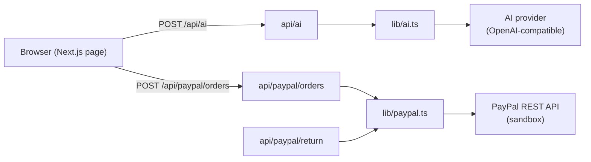
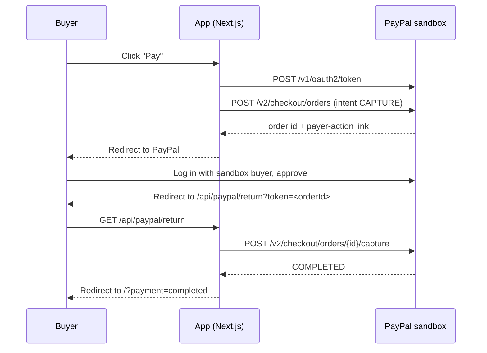

# Architecture

> Update this file as the project grows. GitHub renders the Mermaid diagrams below.

## Components

Secrets live only on the server (`src/lib/env.ts`). The browser never sees PayPal or AI keys.

## Payment flow

## Mock mode

Each integration checks for its own credentials. When they are missing:

| Integration | Behaviour without credentials |
| --- | --- |
| PayPal | `createOrder` returns a `MOCK-` id whose approve URL skips PayPal and goes straight to the return route; `captureOrder` returns `COMPLETED` |
| AI | `chat` echoes the prompt back with a `[mock AI]` prefix |

This keeps the app runnable for anyone who clones the repo without keys, including judges.
