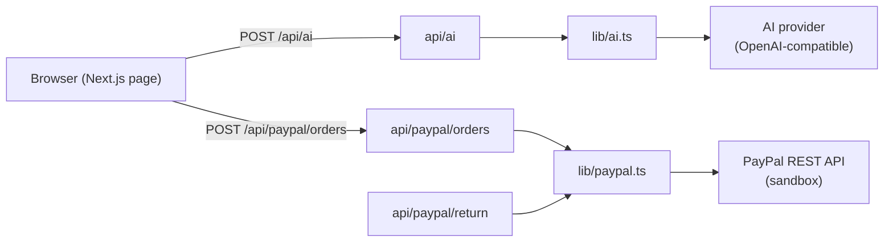
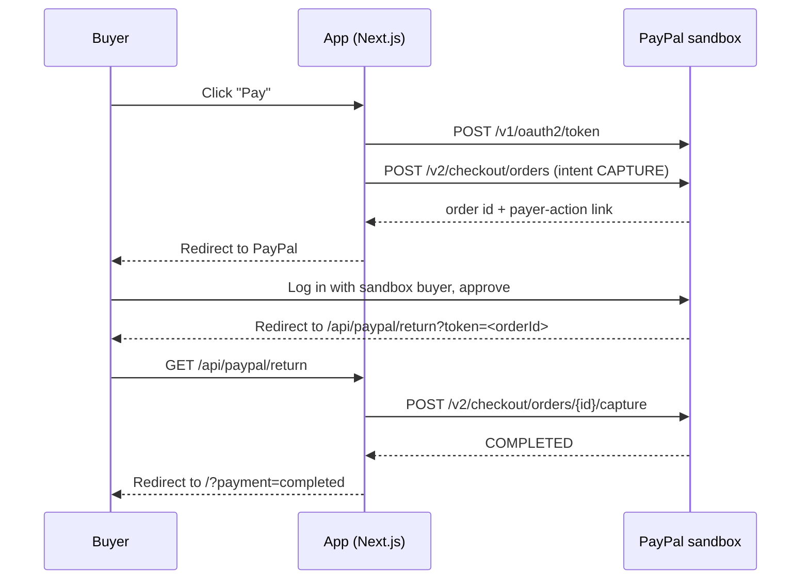
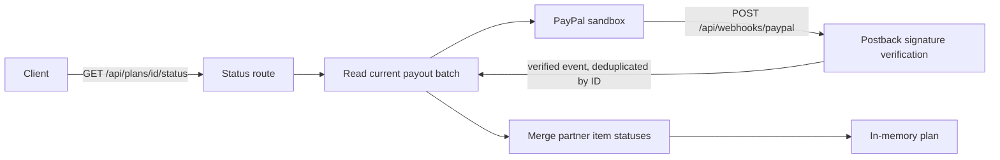

# Architecture

> Update this file as the project grows. GitHub renders the Mermaid diagrams below.

## Components

Secrets live only on the server (`src/lib/env.ts`). The browser never sees PayPal or AI keys.

## Payment flow

## Payout status delivery

The approval route records one Payouts batch ID on the plan. Both status delivery paths call `refreshPayoutStatus()` in `src/lib/plans.ts`:

The webhook's status fields never set payment amounts or directly replace item statuses. A verified event prompts a fresh batch read, so delayed deliveries reconcile with current PayPal data. Each plan has a shared queue for status reads and writes on `globalThis`, preventing responses from being applied out of order. A webhook enqueues its own fresh read after an in-flight poll, even when the poll marks the plan paid. Other plans can reconcile concurrently. Failed reads reject their caller without blocking the queue, and a scenario reset invalidates queued work. A settled item also never regresses to `PENDING`. A batch-level `SUCCESS` does not imply that each partner received money.

Polling skips paid plans. Webhooks may refresh paid plans to record subsequent refunds or reversals. With no credentials, mock polling settles the plan without network access; webhook verification always fails closed. Webhook deduplication is bounded, shared through `globalThis`, and scoped to the current store state. A reset or restart clears it. This demo requires one server instance and does not persist its payment audit history.

## Mock mode

Each integration checks for its own credentials. When they are missing:

| Integration | Behaviour without credentials |
| --- | --- |
| PayPal | `createOrder` returns a `MOCK-` id whose approve URL skips PayPal and goes straight to the return route; `captureOrder` returns `COMPLETED` |
| PayPal Payouts | `createPayoutBatch` returns a `MOCK-BATCH-` id; `getPayoutBatch` reports `PENDING` on the first read and `SUCCESS` after that |
| AI | `chat` echoes the prompt back with a `[mock AI]` prefix |

This keeps the app runnable for anyone who clones the repo without keys, including judges.
